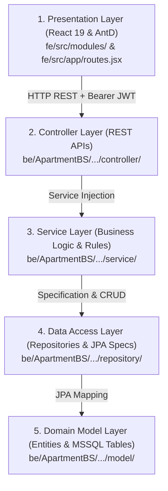

# 🚀 ONBOARDING GUIDE: HỆ THỐNG QUẢN LÝ TÒA NHÀ CHUNG CƯ (SBA301_PC_ABMS)
> **Dành cho:** Lập trình viên / Thành viên mới gia nhập dự án  
> **Tự động sinh bởi:** `Understand-Anything (/understand-onboard)`  
> **Ngày cập nhật:** 29/10/2026  

---

## 1. TỔNG QUAN DỰ ÁN (PROJECT OVERVIEW)

* **Tên dự án:** `SBA301_PC_ABMS` (Apartment Building Management System - ABMS)
* **Mục tiêu:** Số hóa toàn diện quy trình vận hành tòa nhà chung cư bao gồm Quản lý Căn hộ, Cư dân, Phương tiện, Thu phí Điện/Nước/Dịch vụ và Xử lý Sự cố Kỹ thuật.
* **Tech Stack cốt lõi:**
  * **Backend:** Spring Boot 3.4.2, Java 21, Spring Data JPA (Hibernate 6.6), Spring Security (JWT), Microsoft SQL Server 2022.
  * **Frontend:** React 19, Vite 8, Ant Design 6.x, Tailwind CSS (Tuân thủ 100% PlayStation Design System).
  * **Kiểm thử:** TDD Test Suite (JUnit 5, Mockito, SpringBootTest với `@Transactional` rollback).

---

## 2. KIẾN TRÚC 5 TẦNG (ARCHITECTURE LAYERS)

Dự án được phân tách rành mạch theo mô hình 5 tầng kiến trúc:



| Tầng (Layer) | Vai trò & Trách nhiệm chính | Thư mục mã nguồn |
| :--- | :--- | :--- |
| **1. Frontend Presentation** | Giao diện Single Page Application (SPA), phân chia 3 phân hệ theo vai trò (Admin, Resident, Technician), quản lý context và routing. | `fe/src/` |
| **2. Backend Controllers** | Tiếp nhận HTTP Request, kiểm tra phân quyền bảo mật `@PreAuthorize`, xác thực dữ liệu đầu vào `@Valid`. | `be/ApartmentBS/.../controller/` |
| **3. Backend Services** | Xử lý toàn bộ logic tính toán và thực thi các ràng buộc nghiệp vụ (BR-02, BR-04, BR-07). | `be/ApartmentBS/.../service/` |
| **4. Repositories & Specs** | Giao tiếp cơ sở dữ liệu, thực thi truy vấn động bằng **JPA Criteria Specification** an toàn trước SQL Injection. | `be/ApartmentBS/.../repository/` |
| **5. Domain Entities** | Ánh xạ trực tiếp với các bảng vật lý trong Microsoft SQL Server (`ApartmentDB`). | `be/ApartmentBS/.../model/` |

---

## 3. CÁC QUY TẮC NGHIỆP VỤ CỐT LÕI (KEY BUSINESS RULES)

Là thành viên mới, bạn **bắt buộc phải ghi nhớ 3 quy tắc nghiệp vụ quan trọng sau**:

1. **BR-02 (Một cư dân sở hữu nhiều căn hộ):**
   * Một `User` với vai trò `RESIDENT` có thể được gán làm chủ sở hữu của nhiều bản ghi `Apartment`.
   * Giao diện cư dân hỗ trợ dropdown đổi căn hộ linh hoạt (`switchApartment`) qua `ApartmentContext.jsx`.
2. **BR-04 (Chặn dọn đi nếu còn nợ hóa đơn - Move-out Debt Lock):**
   * Khi Admin làm thủ tục dọn đi (`/move-out`) cho một căn hộ, hệ thống kiểm tra: Nếu căn hộ còn bất kỳ hóa đơn nào ở trạng thái `UNPAID` hoặc `PENDING` $\implies$ Ném ngoại lệ `AppException` chặn ngay lập tức.
   * Chỉ khi tất cả hóa đơn đã `PAID`, phòng mới được chuyển về trạng thái `VACANT`.
3. **BR-07 (Cảnh báo sự cố kỹ thuật quá hạn > 24h):**
   * Các sự cố kỹ thuật ở trạng thái `OPEN` nếu quá 24h kể từ lúc tạo mà chưa có thợ nào nhận (`assigned_to == null`) sẽ tự động được hệ thống gắn cờ **OVERDUE (Báo động đỏ)** và ưu tiên đẩy lên đầu danh sách Chợ việc.

---

## 4. HÀNH TRÌNH TỰ HỌC BƯỚC ĐẦU (RECOMMENDED GUIDED TOUR)

Để làm quen với dự án nhanh nhất, hãy đọc code theo đúng 4 chặng sau:

### 📍 Chặng 1: Nắm Yêu Cầu & Bối Cảnh
* **File đọc:** [`ABMS_ProjectGuidelines.md`](file:///e:/Springboot/SBA301_PC_ABMS/SBA301_PC_ABMS/ABMS_ProjectGuidelines.md)
* **Mục tiêu:** Hiểu rõ các tác nhân (Admin, Resident, Technician) và 17 Use Cases của hệ thống.

### 📍 Chặng 2: Khởi động Backend & Bảo Mật
* **File đọc:** 
  * [`ApartmentBsApplication.java`](file:///e:/Springboot/SBA301_PC_ABMS/SBA301_PC_ABMS/be/ApartmentBS/src/main/java/com/example/apartmentbs/ApartmentBsApplication.java) (Entry point).
  * [`SecurityConfig.java`](file:///e:/Springboot/SBA301_PC_ABMS/SBA301_PC_ABMS/be/ApartmentBS/src/main/java/com/example/apartmentbs/config/SecurityConfig.java) (Cấu hình Spring Security stateless, JWT Filter, CORS).
* **Mục tiêu:** Hiểu cơ chế cấp phát token khi login và cách phân quyền API.

### 📍 Chặng 3: Điểm Sáng Kỹ Thuật – Lọc Động Criteria API
* **File đọc:** 
  * [`ApartmentSpecification.java`](file:///e:/Springboot/SBA301_PC_ABMS/SBA301_PC_ABMS/be/ApartmentBS/src/main/java/com/example/apartmentbs/repository/specification/ApartmentSpecification.java)
  * [`HUONG_DAN_THUYET_TRINH_SPECIFICATION.md`](file:///e:/Springboot/SBA301_PC_ABMS/SBA301_PC_ABMS/HUONG_DAN_THUYET_TRINH_SPECIFICATION.md)
* **Mục tiêu:** Hiểu cách Spring Data JPA ghép nối vị từ `where().and()` và kỹ thuật `LEFT JOIN` tìm kiếm đa trường không làm mất phòng trống.

### 📍 Chặng 4: Khởi động Frontend & Điều Hướng
* **File đọc:**
  * [`main.jsx`](file:///e:/Springboot/SBA301_PC_ABMS/SBA301_PC_ABMS/fe/src/main.jsx) (Bootstrap & MockDB baseline).
  * [`routes.jsx`](file:///e:/Springboot/SBA301_PC_ABMS/SBA301_PC_ABMS/fe/src/app/routes.jsx) (Cấu trúc phân quyền giao diện).
  * [`ApartmentManagement.jsx`](file:///e:/Springboot/SBA301_PC_ABMS/SBA301_PC_ABMS/fe/src/modules/admin/ApartmentManagement.jsx) (Màn hình quản trị kết nối Criteria API).

---

## 5. BẢN ĐỒ CÁC FILE QUAN TRỌNG (KEY FILE MAP)

### 🔹 Phân hệ Quản trị Căn hộ (Apartment Module)
* `ApartmentController.java`: Cung cấp 8 API quản lý căn hộ, cư dân, xe cộ.
* `ApartmentServiceImpl.java`: Logic kiểm tra trùng phòng, Move-in tạo User, Move-out chặn nợ.
* `ApartmentSpecification.java`: Bộ lọc động JPA Criteria.
* `ApartmentManagement.jsx`: Giao diện Admin quản trị căn hộ, modal nhận phòng, bảng xe cộ.

### 🔹 Phân hệ Ghi số & Thu phí (Billing & Invoices Module)
* `BillingController.java`: API cấu hình biểu giá đơn giá (`/tariffs`), xuất hóa đơn lẻ/hàng loạt, duyệt gạch nợ.
* `BillingServiceImpl.java`: Công thức tính tiền điện bậc thang, nước, phí quản lý.
* `MeterReading.jsx`: Giao diện ghi số đồng hồ và xuất hóa đơn hàng loạt (Batch Generate).
* `InvoiceApproval.jsx`: Giao diện Admin duyệt gạch nợ thanh toán.
* `MyInvoices.jsx`: Giao diện Cư dân xem hóa đơn và bấm nút xác nhận chuyển khoản.

### 🔹 Phân hệ Xử lý Sự cố Kỹ thuật (Ticket Module)
* `TicketController.java`: API báo sự cố, chợ việc, nhận việc, hoàn thành, nghiệm thu.
* `TicketServiceImpl.java`: Logic chuyển trạng thái vé, kiểm tra chống xung đột (Atomic claim).
* `ReportTicket.jsx`: Cư dân báo sự cố & đánh giá 1-5 sao hoặc yêu cầu làm lại.
* `TaskPool.jsx`: Kỹ thuật viên xem chợ việc chung (>24h cảnh báo) và nhận việc.
* `MyTasks.jsx`: Kỹ thuật viên xem việc đang nhận và gửi biên bản hoàn thành.

---

## 6. CÁC ĐIỂM NÓNG CẦN CHÚ Ý (COMPLEXITY HOTSPOTS)

Khi chỉnh sửa các file dưới đây, bạn cần **đặc biệt cẩn trọng**:

1. **`ApartmentManagement.jsx` (Giao diện Admin - 1698 dòng):**
   * *Độ phức tạp:* Rất cao.
   * *Lý do:* Tích hợp cùng lúc 5 modal nghiệp vụ (Thêm/Sửa phòng, Move-in, Move-out, Phương tiện, Chi tiết), debounce gọi API Criteria lọc động 250ms, và tính toán số liệu thống kê card tổng quan.
2. **`ApartmentSpecification.java` (Lọc động Backend):**
   * *Độ phức tạp:* Trung bình - Cao.
   * *Lý do:* Sử dụng `Join<Apartment, User> residentJoin = root.join("resident", JoinType.LEFT)`. Tuyệt đối không đổi thành `INNER JOIN` vì sẽ làm biến mất các căn hộ đang trống khỏi kết quả tìm kiếm!
3. **`BillingServiceImpl.java` (Tính tiền & Xuất hóa đơn hàng loạt):**
   * *Độ phức tạp:* Cao.
   * *Lý do:* Xử lý Transactional nhiều bản ghi hóa đơn cùng lúc, tính toán tiền theo đơn giá bậc thang và số lượng xe thực tế của từng phòng.

---

## 7. HƯỚNG DẪN CHẠY DỰ ÁN TRÊN MÁY LOCAL

### Bước 1: Khởi động Cơ sở dữ liệu
* Đảm bảo Microsoft SQL Server đang chạy tại `localhost:1433`.
* Database name: `ApartmentDB` (User: `as`, Password: `1` theo file `application.properties`).

### Bước 2: Chạy Backend Spring Boot
```powershell
$env:JAVA_HOME = "C:\Program Files\Java\jdk-21"
cd be\ApartmentBS
.\mvnw.cmd spring-boot:run
```
*(Backend sẽ lắng nghe tại `http://localhost:8080`)*

### Bước 3: Chạy Test Suite TDD để kiểm tra hệ thống
```powershell
cd be\ApartmentBS
.\mvnw.cmd test
```
*(Yêu cầu: Toàn bộ 11/11 tests phải Passed)*

### Bước 4: Khởi động Frontend
```powershell
cd fe
npm install
npm run dev
```
*(Frontend sẽ mở tại `http://localhost:5173`)*
